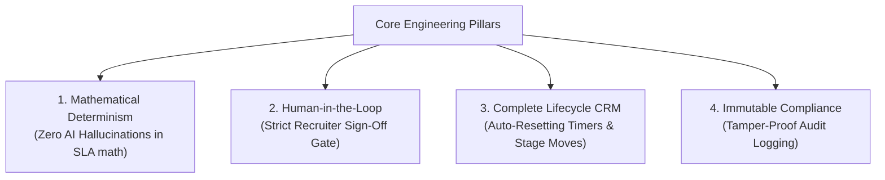
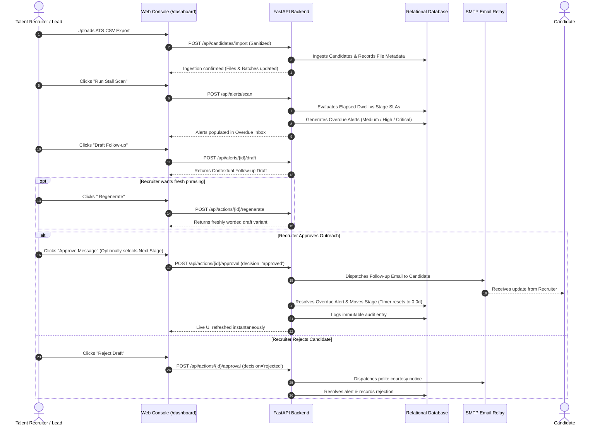
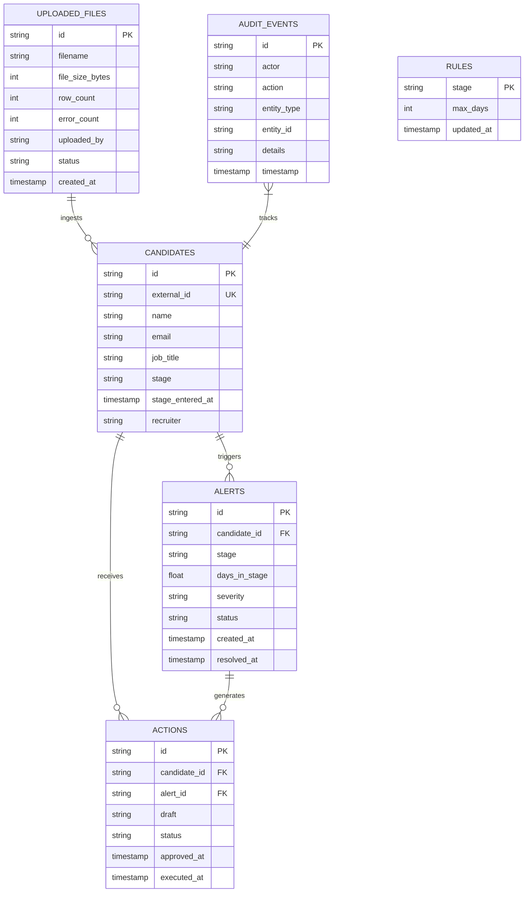

# STALL ALERTER — PRODUCT PHILOSOPHY & ENGINEERING INTENT (INTENT.md)

**System Name:** Stall Alerter  
**Version:** 2.5.0 (Enterprise Production Release)  
**Classification:** Recruiting Operations Copilot & SLA Monitoring Infrastructure  
**Core Standard:** Zero Autonomous Decision-Making • Human-in-the-Loop • Deterministic Reliability

---

## 1. The Core Problem Statement

In modern talent acquisition, organizations spend millions of dollars sourcing candidates, yet lose up to **35% of high-intent applicants** due to a single operational failure: **Pipeline Stagnation**.

### The Anatomy of a Hiring Stall:
1. An applicant passes an initial round (e.g. *Technical Interview*).
2. The interviewer delays submitting a scorecard, or the hiring team is overwhelmed with daily engineering responsibilities.
3. The candidate sits in the pipeline with zero updates for 10, 15, or 20+ days.
4. The candidate assumes rejection, accepts an offer from an agile competitor, or disengages permanently.

### Why Standard ATS Systems Fail:
Existing Applicant Tracking Systems (Greenhouse, Lever, Workday) are passive record-keepers. They report what *has already happened* (lagging metrics) rather than actively monitoring what is *failing to happen right now* (leading SLA breach indicators).

---

## 2. The Architectural Philosophy (The "Stall Alerter" Way)

Stall Alerter was engineered around four non-negotiable principles:

### Pillar 1: Mathematical Determinism Over AI Hype
AI models are prone to hallucination, drift, and non-deterministic variations. Calculating whether a candidate has exceeded an SLA threshold is a **pure mathematical operation**:
$$\text{Elapsed Days} = \frac{t_{\text{current}} - t_{\text{stage\_entered}}}{86,400\text{ seconds}}$$
Stall Alerter never asks an LLM *"Is this candidate stalled?"*. Instead, the deterministic Python engine evaluates the exact UTC dwell duration against configured thresholds and classifies urgency into:
- **Medium Urgency:** $\text{Dwell} \ge 1.0\times \text{SLA}$
- **High Urgency:** $\text{Dwell} \ge 1.5\times \text{SLA}$
- **Critical Urgency:** $\text{Dwell} \ge 2.0\times \text{SLA}$

### Pillar 2: Human-in-the-Loop (HITL) Governance
Under NO circumstances does Stall Alerter send automated communications to external candidates autonomously. The system acts as a **smart draft co-pilot**:
- It prepares a contextual, respectful follow-up draft.
- It provides a **1-click Regeneration tool** for alternative phrasing.
- An authorized recruiter must explicitly review, optionally edit, and click **"Approve Message"** before SMTP dispatch.

### Pillar 3: Closed-Loop Lifecycle Management
Alerts must not be dead ends. Resolving a stall means either:
1. Re-engaging the candidate with status follow-up communication.
2. Advancing the candidate to the next interview stage, which **immediately resets the dwell timer to 0.0 days**.
3. Rejecting the candidate with a polite, professional courtesy notice.

### Pillar 4: Zero-Biased Operational Scope
Stall Alerter strictly manages **recruiting operations velocity**. It:
- **NEVER** ranks candidate merit, employability, or qualification.
- **NEVER** analyzes candidate resumes for cultural fit or sentiment.
- **NEVER** makes automated rejection or advancement choices without human authorization.

---

## 3. Complete End-to-End Operational Lifecycle

---

## 4. Data Entity Design & Relationships

The relational architecture ensures referential integrity and audit compliance:

---

## 5. Industry Best Practices & Engineering Standard

Stall Alerter follows standards taught in top-tier software engineering and product management programs:
1. **WCAG 2.2 AA Compliance:** High-contrast accessible color tokens, semantic HTML, and responsive mobile-first bottom sheets.
2. **RESTful API Idempotency:** Alert scans and rule updates are idempotent; rerunning never creates duplicate state.
3. **Database WAL Mode:** High concurrency with Write-Ahead Logging allows simultaneous reads and writes without thread starvation.
4. **CSV Injection Defense:** Strips executable formula triggers (`=`, `+`, `-`, `@`) during candidate ingestion.
5. **Separation of Concerns:** Zero UI business logic; the frontend serves as an operational cockpit for the backend state machine.
