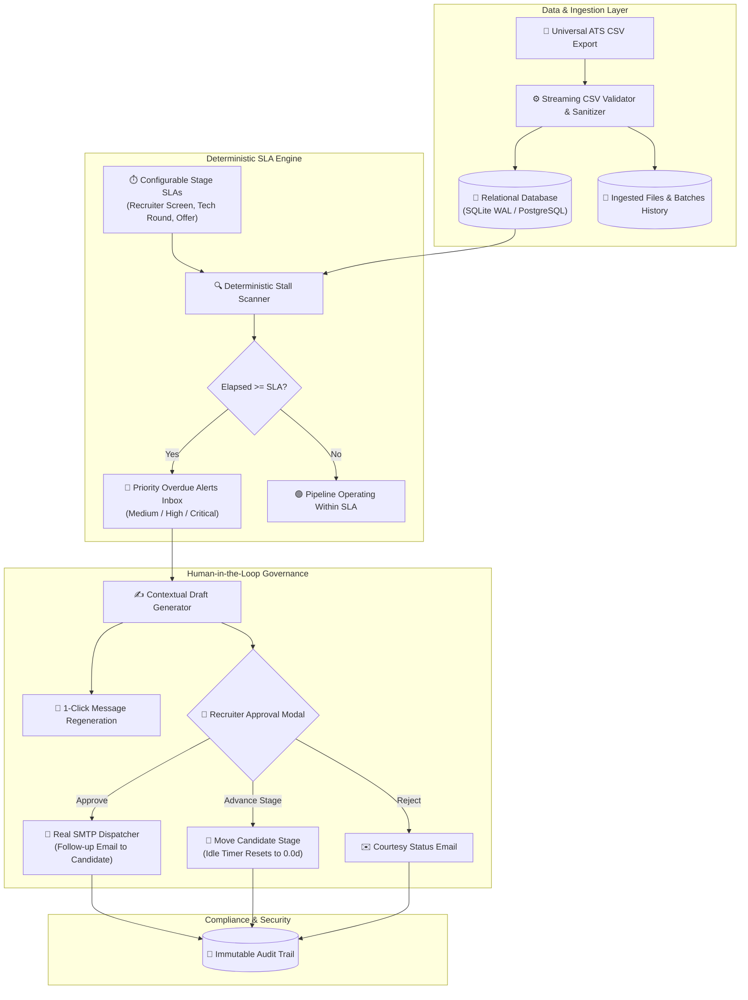

# STALL ALERTER
> Production-Grade, Security-First, Operational Recruiting Copilot for Candidate Stall Detection, SLA Governance, and Automated Candidate Communication.

[](https://github.com/ajayroll1/Stall_Alert/actions)
[-black?style=flat&logo=next.js)](https://nextjs.org)
[](https://fastapi.tiangolo.com)
[](https://www.python.org)
[](https://www.typescriptlang.org)
[](LICENSE)

---

## 📌 Executive Summary & Product Mission

High-growth companies frequently lose top-tier talent not due to compensation or competition, but due to **unintentional pipeline stagnation**—candidates sitting unattended in an interview stage exceeding operational SLAs (Service Level Agreements) without proactive communication.

**Stall Alerter** operates as a mission-critical operational co-pilot for talent acquisition leaders:
1. **Detects Bottlenecks Deterministically:** Computes exact dwell days per candidate stage down to fractional decimals using UTC clock precision.
2. **Prioritizes Urgency:** Automatically assigns severity tiers (*Medium $\ge 1\times$ SLA*, *High $\ge 1.5\times$ SLA*, *Critical $\ge 2.0\times$ SLA*).
3. **Drafts Contextual Outreach & Message Regeneration:** Prepares personalized, respectful follow-up drafts with 1-click alternative tone regeneration.
4. **Human-in-the-Loop Governance:** Enforces mandatory human approval before outbound email dispatch—zero autonomous AI actions leave without recruiter sign-off.
5. **Real SMTP Email Dispatch:** Dispatches approved updates or polite rejection notices directly to candidates via secure SMTP (Gmail / Custom relay).
6. **Complete Pipeline Lifecycle:** Moves candidates across interview stages directly from the UI, auto-resetting dwell timers to `0.0 days`.
7. **Files & Batches Ingestion History:** Tracks every uploaded CSV with metadata, row counts, and 1-click re-download capability.
8. **Immutable Compliance Audit Trail:** Records all operational decisions, deletions, and state transitions in an append-only audit event log.

---

## 🏛️ System Architecture



---

## 🌟 Key Features

| Capability | Technical Description | Business Impact |
| :--- | :--- | :--- |
| **Deterministic Stall Scanner** | Mathematically computes dwell duration without AI hallucination. | Zero false-positive or missed candidate escalations. |
| **Multi-Stage SLA Configuration** | Dynamic threshold configuration per interview stage. | Adaptable to distinct engineering, product, or sales hiring bars. |
| **1-Click Message Regeneration** | Generates alternative respectful phrasing variants on demand. | Recruiter saves time crafting contextual follow-ups. |
| **Stage Progression & Timer Reset** | Move candidates across stages; dwell days auto-reset to `0.0d`. | Complete closed-loop candidate CRM lifecycle. |
| **Real SMTP Candidate Delivery** | Dual-flow email dispatch (Approval update & polite rejection). | High candidate engagement and brand reputation. |
| **Files & Ingestion History** | Track all uploaded batches with size, row count, and download. | Full traceability and batch auditability. |
| **Unified Deletion Governance** | Clean top toolbar delete mode with select-all & bulk delete. | Intuitive, clutter-free enterprise UI experience. |
| **Zero-Bias AI Guardrails** | Strictly operational coordination; never ranks employability. | Complete adherence to EEOC fairness and hiring compliance. |

---

## 💻 Tech Stack

- **Frontend:** Next.js 16.4 (App Router, Turbopack, React 19, TypeScript 5.0)
- **Styling:** Custom Enterprise B2B Design System (WCAG 2.2 AA compliant, mobile-first responsive bottom sheets)
- **Backend:** FastAPI (Python 3.11+, Pydantic v2 schemas, ASGI asynchronous runtime)
- **Database:** SQLite 3 with Write-Ahead Logging (WAL) and B-Tree indexes (PostgreSQL-ready)
- **Email Service:** Python `smtplib` + MIME multipart HTML/Text with TLS encryption
- **DevOps:** Docker, Docker Compose, GitHub Actions CI, Vercel & Render Cloud Hosting

---

## ⚡ Quick Start (Local Run)

### 1. Prerequisites
- Python 3.11+
- Node.js 18+ and npm

### 2. Backend Setup
```bash
# Clone the repository
git clone https://github.com/ajayroll1/Stall_Alert.git
cd Stall_Alert

# Install Python dependencies
pip install -r requirements.txt

# Start FastAPI server
python -m uvicorn app.main:app --host 127.0.0.1 --port 8000 --reload
```
- API Base URL: `http://127.0.0.1:8000`
- Interactive Swagger UI: `http://127.0.0.1:8000/docs`

### 3. Frontend Setup
```bash
# In a new terminal, navigate to web directory
cd web
npm install

# Start Next.js development server
npm run dev
```
- Recruiter Dashboard: `http://localhost:3000/dashboard`

---

## 🚀 Live Cloud Deployment

For detailed free hosting instructions on **Render** (Backend) and **Vercel** (Frontend), refer to [`DEPLOYMENT.md`](DEPLOYMENT.md).

---

## 📜 Documentation Directory

- [`INTENT.md`](INTENT.md) — Product philosophy, engineering architecture, and problem statement.
- [`WORKING.md`](WORKING.md) — Step-by-step lifecycle workflows, state diagrams, and SLA formulas.
- [`COMMAND.md`](COMMAND.md) — Complete CLI execution, testing, and deployment commands.
- [`MARK.md`](MARK.md) — Production-grade feature completion checklist and verification records.
- [`docs/API.md`](docs/API.md) — Comprehensive OpenAPI endpoint schemas and security contracts.
- [`docs/SECURITY.md`](docs/SECURITY.md) — Authentication, CSV sanitization, and PII protection policies.
- [`docs/AI_GUARDRAILS.md`](docs/AI_GUARDRAILS.md) — Non-negotiable fairness and AI governance boundaries.

---

## 📄 License
Licensed under the Apache License, Version 2.0. See [LICENSE](LICENSE) for details.
