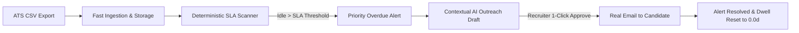

# STALL ALERTER 🚀
### Intelligent, Human-Governed Hiring Pipeline Monitoring & Candidate Care

[](https://stall-alert.vercel.app)
[](https://stall-alert.onrender.com)
[](https://nextjs.org/)
[](https://fastapi.tiangolo.com/)
[](https://sqlite.org/)

---

## 📌 What is Stall Alerter?
**Stall Alerter** is an operational console built for talent acquisition teams and recruiters. It stops candidates from falling through the cracks by actively monitoring how long each applicant has been waiting at their current interview stage.

When a candidate exceeds the company's agreed-upon Service Level Agreement (SLA), Stall Alerter flags them with a clear priority alert, writes a personalized update email, and allows the recruiter to review, edit, advance their stage, and send the email with **a single click**.



---

## 🌐 Live Production URLs

| Component | Platform | URL |
|---|---|---|
| **Recruiter Dashboard** | Vercel | [https://stall-alert.vercel.app](https://stall-alert.vercel.app) |
| **Backend API Root** | Render | [https://stall-alert.onrender.com](https://stall-alert.onrender.com) |
| **Interactive API Docs (Swagger)** | Render | [https://stall-alert.onrender.com/docs](https://stall-alert.onrender.com/docs) |
| **Alternative Docs (ReDoc)** | Render | [https://stall-alert.onrender.com/redoc](https://stall-alert.onrender.com/redoc) |
| **API Health Check** | Render | [https://stall-alert.onrender.com/health](https://stall-alert.onrender.com/health) |

---

## ✨ Key Features & Capabilities

- **Deterministic SLA Breach Detection:** Alert severity (*Medium*, *High*, *Critical*) is calculated using exact mathematical time elapsed ($T_{\text{current}} - T_{\text{entered}} > \text{SLA}$), not unpredictable AI guesses.
- **1-Click Review & Approve:** Clean outreach modal with instant optimistic dismissal. No lag, no double-clicking.
- **1-Click Draft Regeneration:** Re-synthesize and rewrite follow-up messages instantly with the *Regenerate* button.
- **Candidate Stage Progression:** Move candidates forward (e.g. *Phone Screen* $\rightarrow$ *Technical Interview*) directly from the dashboard or approval modal. Automatically resets candidate dwell time to `0.0 days` and resolves active alerts.
- **Files & Batches Audit Section:** Complete historical view of all ingested CSV files with metadata and one-click re-download capability.
- **Real SMTP Candidate Delivery:** Approved messages and polite rejections are delivered directly to candidate email addresses.
- **Bulk Delete Operations:** Easily clean up candidate batches and dismissed alerts with select-all tools.
- **Immutable Audit Log:** Chronological, read-only record tracking every import, scan, approval, and stage advancement.

---

## 🛠️ Step-by-Step Local Setup & Run Guide

Running Stall Alerter on your local machine is straightforward. Follow these steps.

### Step 1: Clone the Repository
Open your terminal or command prompt and clone the repository:
```bash
git clone https://github.com/ajayroll1/Stall_Alert.git
cd Stall_Alert
```

---

### Step 2: Set Up & Run the Backend (Python FastAPI)

1. **Verify Python Installation:**
   Ensure Python 3.11+ or 3.14+ is installed:
   ```bash
   python --version
   ```

2. **Install Python Dependencies:**
   ```bash
   pip install -r requirements.txt
   ```

3. **Configure Environment Variables:**
   Copy the example environment template:
   ```bash
   cp .env.example .env
   ```
   *(For local testing, the default settings work right out of the box).*

4. **Start the FastAPI Backend Server:**
   ```bash
   python -m uvicorn app.main:app --host 127.0.0.1 --port 8000 --reload
   ```
   - **Backend URL:** `http://127.0.0.1:8000`
   - **Interactive Swagger Docs:** `http://127.0.0.1:8000/docs`
   - **Healthcheck:** `http://127.0.0.1:8000/health`

---

### Step 3: Set Up & Run the Frontend (Next.js 16)

Open a **new terminal window** in the project directory:

1. **Navigate to the `web` Directory:**
   ```bash
   cd web
   ```

2. **Install Node.js Packages:**
   ```bash
   npm install
   ```

3. **Verify Local Environment File:**
   Ensure a file named `.env.local` exists inside the `web` folder with these contents:
   ```env
   NEXT_PUBLIC_API_URL=http://127.0.0.1:8000
   NEXT_PUBLIC_API_KEY=dev-stall-alerter-secret-key-32chars-min
   ```

4. **Start the Next.js Development Server:**
   ```bash
   npm run dev
   ```
   - **Recruiter Console URL:** `http://localhost:3000` (or `http://localhost:3000/dashboard`)

---

### Step 4: Quick One-Click Run (Windows Users)
If you are on Windows, you can start both the backend and frontend simultaneously by double-clicking:
```cmd
start_all.bat
```

---

## 🧪 Testing the System (Step-by-Step Walkthrough)

1. Open your browser and go to `http://localhost:3000/dashboard`.
2. Click **+ Upload New CSV** or click the top-right import icon.
3. Select the provided sample data file located at `examples/candidates.csv` (or any custom CSV export).
4. Click **Upload & Process**. The system will show a green checkmark `✅ Success! Imported X rows` and auto-close smoothly.
5. In the **Overdue Alerts** tab, click **Draft Follow-up** for any candidate who exceeded SLA.
6. In the modal:
   - Click **Regenerate** if you'd like an alternative draft.
   - Choose a new stage from the dropdown if you want to advance the candidate.
   - Click **Approve Message** to send the email and resolve the alert!

---

## 📁 Project Structure

```
Stall_Alert/
├── app/                  # FastAPI backend server
│   ├── __init__.py
│   └── main.py           # Core REST API, SLA logic, database initialization, email service
├── docs/                 # Complete project documentation & reflections
│   ├── DIRECTIVE.md      # Core architectural charter & non-negotiables
│   ├── 5_DAY_LOGBOOK.md  # Detailed chronological 5-day engineering log
│   ├── UNLEARNED.md      # A one-page reflection on what we unlearned
│   ├── API.md            # Complete REST API reference & payload contracts
│   ├── ARCHITECTURE.md   # System architecture diagrams & data model (ERD)
│   ├── SECURITY.md       # STRIDE threat model & data defense policies
│   └── TECH_STACK.md     # Technology choices and justification
├── examples/             # Sample datasets for testing (candidates.csv)
├── web/                  # Next.js 16 frontend application
│   ├── src/
│   │   ├── app/          # App router pages (dashboard/page.tsx, landing page)
│   │   ├── components/   # UI components (ProductTourModal, FluidFooter, Modals)
│   │   ├── api.ts        # Typed API client
│   │   └── types.ts      # TypeScript data models
│   ├── package.json
│   └── .env.local        # Frontend environment config
├── Dockerfile            # Container definition
├── docker-compose.yml    # Multi-container orchestration
├── requirements.txt      # Python dependencies
├── start_all.bat         # Windows one-click local launcher
└── README.md             # This document
```

---

## 📄 Key Engineering Documentation Links

- 📋 [**Final Directive (docs/DIRECTIVE.md)**](file:///C:/Users/LENOVO/Desktop/Stall_Alert/docs/DIRECTIVE.md): System charter, core problem, and non-negotiables.
- 📅 [**5-Day Engineering Logbook (docs/5_DAY_LOGBOOK.md)**](file:///C:/Users/LENOVO/Desktop/Stall_Alert/docs/5_DAY_LOGBOOK.md): Realistic, chronological daily log of how Stall Alerter was built.
- 💡 [**What We Unlearned (docs/UNLEARNED.md)**](file:///C:/Users/LENOVO/Desktop/Stall_Alert/docs/UNLEARNED.md): Real-world reflections on simplicity, AI hype, and human governance.
- 🔌 [**REST API Documentation (docs/API.md)**](file:///C:/Users/LENOVO/Desktop/Stall_Alert/docs/API.md): Request and response schemas for all endpoints.
- 🏗️ [**System Architecture (docs/ARCHITECTURE.md)**](file:///C:/Users/LENOVO/Desktop/Stall_Alert/docs/ARCHITECTURE.md): Component diagrams, sequence flows, and database ERD.
- 🛡️ [**Security Specification (docs/SECURITY.md)**](file:///C:/Users/LENOVO/Desktop/Stall_Alert/docs/SECURITY.md): Threat modeling, sanitization, and secrets management.

---

## ⚖️ License
Released under the MIT License. Built with care for engineering and talent teams worldwide.
