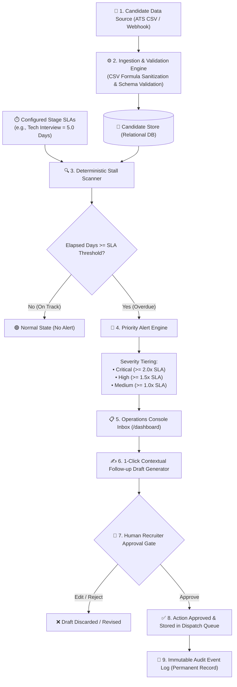
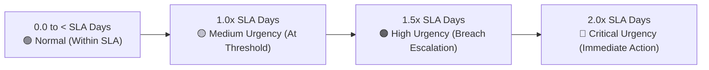
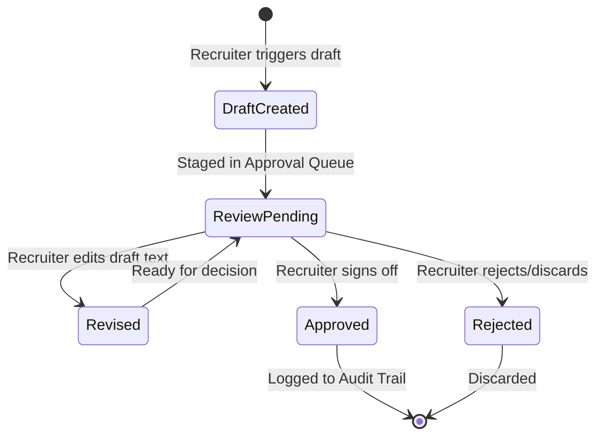
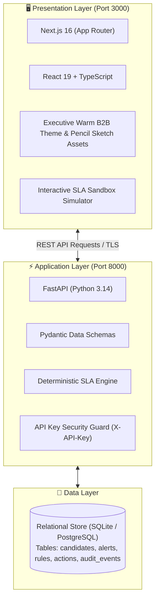

# STALL ALERTER — COMPLETE WORKING & ARCHITECTURAL GUIDE (WORKING.md)

This comprehensive guide details the complete end-to-end operational workflow, architectural data flows, and security boundaries of **Stall Alerter** in clear, structured English with visual flowcharts and state diagrams.

---

## 1. Core Problem & Product Mission

### The Problem:
Recruiting teams at high-growth companies regularly lose top-tier candidates because applications get stuck ("stalled") in a specific interview stage without timely follow-up:
- Interviewers delay submitting feedback, or hiring managers forget pending profiles.
- Highly sought-after candidates become disengaged or accept competing offers.
- Standard ATS tools lack deterministic, stage-level SLA breach alerts and require tedious manual pipeline auditing.

### The Solution (Stall Alerter):
**Stall Alerter** acts as an autonomous operational co-pilot for talent acquisition teams:
1. Ingests candidate pipelines via universal ATS exports or direct integration webhooks.
2. Applies stage-specific Service Level Agreements (SLAs).
3. Deterministically computes elapsed dwell duration down to decimal days using UTC timestamps.
4. Generates prioritized, deduplicated alerts ranked by operational urgency (Medium, High, Critical).
5. Automatically prepares contextual, neutral follow-up communication drafts.
6. Enforces a strict **Human-in-the-Loop** approval gate—ensuring zero automated actions leave the system without authorized recruiter sign-off.
7. Logs every event into an immutable security audit trail.

---

## 2. End-to-End Architectural Data Flow

---

## 3. Step-by-Step Technical Lifecycle

### Step 1: Candidate Ingestion & Defensive Sanitization
- **Source:** Recruiter uploads an ATS export (e.g., `candidates.csv`).
- **Defensive Engineering:**
  - Guards against **CSV Formula Injection** by prefixing cells starting with `=`, `+`, `-`, or `@` with a single quote.
  - Validates ISO-8601 timestamps and ensures required headers (`external_id`, `name`, `email`, `stage`, `stage_entered_at`) are present.
  - Employs idempotent upserts using the candidate's stable external ID to prevent duplicate records.

---

### Step 2: Dynamic Stage SLA Configuration
Recruiting operations leaders configure maximum permissible dwell duration (in days) per hiring stage:
- **Application Review:** 3.0 Days
- **Recruiter Screen:** 5.0 Days
- **Technical Interview:** 5.0 Days
- **Onsite Loop:** 7.0 Days
- **Offer Extended:** 3.0 Days

All SLA rule updates are persisted to the database and permanently logged with the updater's identity.

---

### Step 3: Deterministic Elapsed Days & Severity Algorithm
Stall Alerter does **not** rely on probabilistic LLM guesswork to evaluate time or compliance. It utilizes precise mathematical evaluation:

$$\text{Elapsed Days} = \max\left(0, \frac{\text{Current Time (UTC)} - \text{Stage Entered Time (UTC)}}{86400 \text{ seconds}}\right)$$

#### Urgency Classification Rules:

*Example:* If a candidate is in *Technical Interview* (SLA = 5 days) for 11 days, elapsed ratio is $11 / 5 = 2.2\times$, immediately generating a **CRITICAL** alert.

---

### Step 4: Alert Inbox & Automated Reconciliation
- Alerts are grouped and sorted by severity (Critical first) and age.
- **Reconciliation & Deduplication:** If a candidate transitions to a new stage in the ATS, the previous alert is automatically closed, and a new timer begins.
- If days elapse further while in the same stage, the alert's severity dynamically upgrades (e.g., High $\rightarrow$ Critical) without creating spam duplicate rows.

---

### Step 5: 1-Click Contextual Follow-Up Draft Generation
- Clicking **"Create Draft"** produces a courteous, neutral follow-up communication referencing the candidate's name, role, recruiter, and current interview step.
- **Guardrail:** The draft never makes unauthorized commitments or reveals internal evaluation scores.

---

### Step 6: Human-in-the-Loop Approval Gate (Safety Boundary)

**Zero Autonomous Dispatch Policy:** No outbound communication is ever transmitted without affirmative, authenticated human review and approval. Recruiters retain full editing control.

---

### Step 7: Immutable Security & Audit Logging
Every sensitive action writes an append-only event to the `audit_events` ledger:
- `CSV_IMPORT`: Operator, row count, error summary.
- `UPDATE_RULE`: Admin, modified stage, new threshold.
- `SCAN_ALERTS`: Batch timestamp, new alerts generated, resolved alerts.
- `CREATE_DRAFT`: Generated action ID, associated alert ID.
- `ACTION_APPROVED`: Reviewer name, approval timestamp.

---

## 4. System Topology & Technology Stack

---

## 5. Operations Summary Matrix

| Phase | Core Action | Execution Agent | Security & Integrity Control |
| :--- | :--- | :--- | :--- |
| **1. Ingestion** | Parse CSV / Webhook data | System Service | Formula injection escaping & schema validation |
| **2. SLA Audit** | Compute dwell time vs. thresholds | Deterministic Math Engine | UTC timestamps; zero model hallucination |
| **3. Prioritization** | Rank alerts by urgency | Alert Dispatcher | Automatic deduplication & state reconciliation |
| **4. Drafting** | Prepare follow-up messages | Template Engine | Neutral, non-binding communication standards |
| **5. Authorization** | Approve or reject actions | Human Recruiter | Mandatory Human-in-the-Loop approval gate |
| **6. Accountability** | Record audit log | Audit Engine | Tamper-evident, immutable activity tracking |

This architecture ensures high-volume hiring pipelines maintain momentum, eliminates candidate ghosting, and protects organizational compliance through rigorous human governance.
