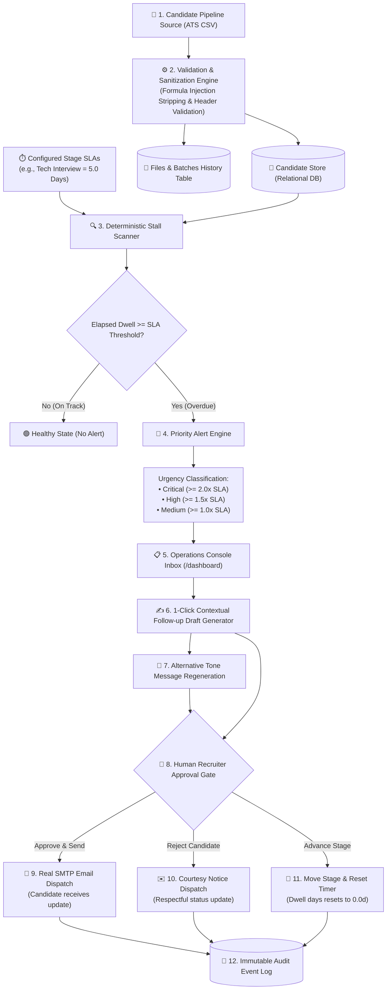
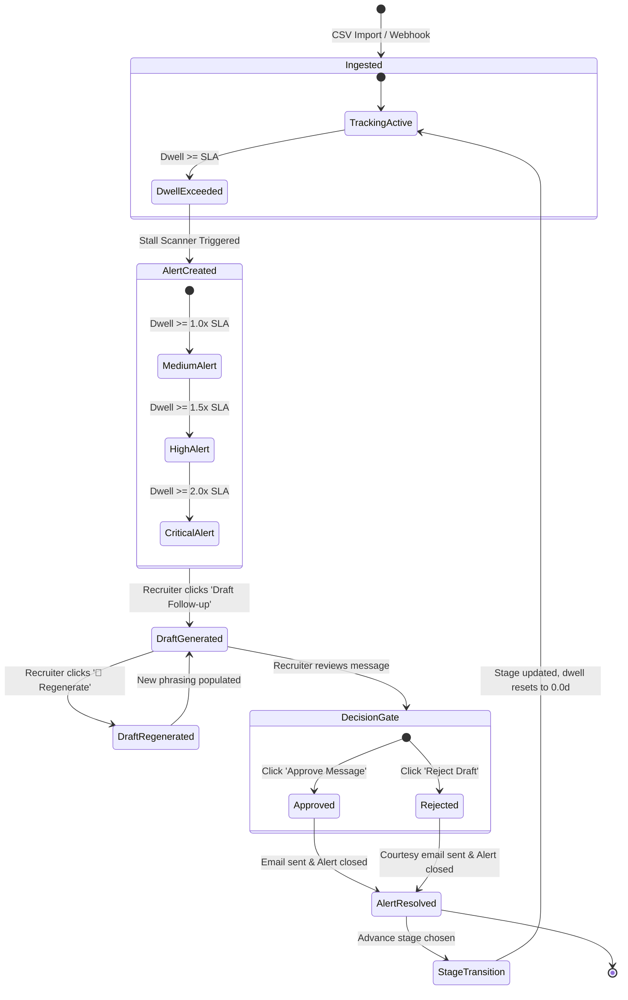

# STALL ALERTER — COMPLETE WORKING & ARCHITECTURAL GUIDE (WORKING.md)

This comprehensive operational guide details the complete end-to-end operational workflow, architectural data flows, mathematical rules, and security boundaries of **Stall Alerter** in structured technical English with Mermaid sequence, state, and flow diagrams.

---

## 1. System Overview & Problem Solved

Recruiting teams at high-growth tech companies regularly lose premier talent because applications sit stagnant in interview pipelines without timely follow-up.

**Stall Alerter** solves this by:
1. Ingesting candidate pipelines via ATS CSV exports or real-time webhooks.
2. Applying dynamic stage-level Service Level Agreements (SLAs).
3. Deterministically calculating idle dwell time using UTC timestamps.
4. Ranking bottlenecks into actionable urgency tiers (Medium, High, Critical).
5. Preparing context-aware follow-up communication with on-demand alternative phrasing regeneration.
6. Enforcing strict **Human-in-the-Loop** approval gating before SMTP email transmission.
7. Supporting real-time candidate stage advancement with automatic dwell time reset to `0.0 days`.
8. Logging all decisions into an immutable compliance audit trail.

---

## 2. End-to-End Architectural Data Flow

---

## 3. Candidate & Alert State Machine

---

## 4. Mathematical Determinism: SLA & Elapsed Math

Stall Alerter does not rely on stochastic LLM outputs to determine SLA breaches. All calculations are executed with microsecond UTC mathematical precision:

### A. Elapsed Time Calculation
$$\Delta t = t_{\text{now (UTC)}} - t_{\text{stage\_entered (UTC)}}$$
$$\text{Elapsed Days} = \max\left(0.0, \frac{\Delta t}{86400}\right)$$

### B. Urgency Threshold Determination
Given an interview stage SLA limit $S_{\text{max}}$:
- **Low (Within SLA):** $\text{Elapsed} < S_{\text{max}}$
- **Medium Urgency:** $S_{\text{max}} \le \text{Elapsed} < 1.5 \times S_{\text{max}}$
- **High Urgency:** $1.5 \times S_{\text{max}} \le \text{Elapsed} < 2.0 \times S_{\text{max}}$
- **Critical Urgency:** $\text{Elapsed} \ge 2.0 \times S_{\text{max}}$

### C. Automatic Stage Advance Dwell Reset
When a candidate is moved to a new stage $S_{\text{new}}$:
$$t_{\text{stage\_entered}} \leftarrow t_{\text{now (UTC)}}$$
$$\text{Days In Stage} \leftarrow 0.00\text{ days}$$
Existing open overdue alerts for the previous stage are marked `status = 'resolved'`.

---

## 5. Security, Privacy & Compliance Architecture

1. **Human-in-the-Loop Isolation:** No outbound email can be triggered without an authorized, signed HTTP `POST /api/actions/{id}/approval` request containing an explicit decision.
2. **CSV Formula Sanitization:** Defense against CSV Injection (CWE-1236) by prepending a single quote (`'`) to any string starting with `=`, `+`, `-`, `@`, `\t`, or `\r`.
3. **API Key Authentication:** Every operational endpoint requires an `X-API-Key` header verified against high-entropy secrets.
4. **Append-Only Audit Log:** The `audit_events` table contains immutable entries with actor ID, entity ID, timestamps, and action descriptions. Logs cannot be modified or rewritten.
5. **PII Minimization:** The system only stores essential recruitment coordination fields (`name`, `email`, `role`, `stage`, `recruiter`). It never collects national IDs, financial data, or health records.
