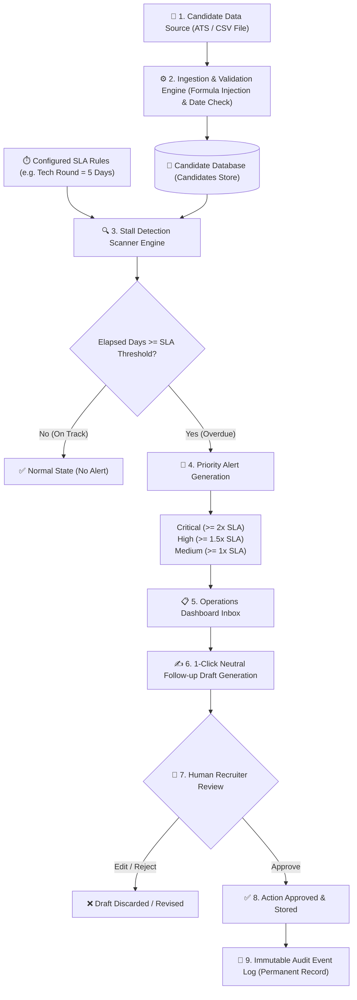
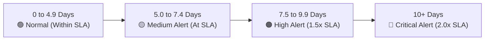
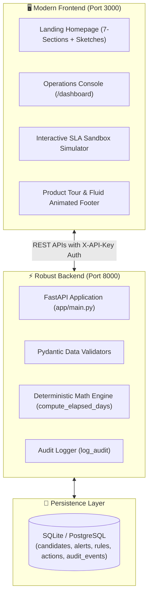

# STALL ALERTER — COMPLETE WORKING & ARCHITECTURE GUIDE (WORKING.md)

इस गाइड में **Stall Alerter** के काम करने का पूरा तरीका (End-to-End Workflow) सबसे आसान भाषा (Simple Hinglish) में फ्लोचार्ट और डायग्राम्स के साथ समझाया गया है।

---

## 1. मुख्य समस्या और उद्देश्य (Core Problem & Mission)

### समस्या (The Problem):
कंपनियों में जब हायरिंग चलती है, तो कई बार अच्छे कैंडिडेट्स का एप्लीकेशन किसी एक राउंड (जैसे: *Technical Interview* या *Screening*) में हफ्तों तक अटका (Stuck/Stalled) रह जाता है। 
- रिक्रूटर्स भूल जाते हैं कि किसको फॉलो-अप करना है।
- कैंडिडेट बोर होकर या ऑफर न मिलने पर दूसरी कंपनी जॉइन कर लेता है।

### समाधान (The Solution — Stall Alerter):
**Stall Alerter** एक ऐसा सिस्टम है जो:
1. हायरिंग पाइपलाइन का डेटा (CSV या ATS) पढ़ता है।
2. यह देखता है कि कौन सा कैंडिडेट अपनी तय समय सीमा (SLA - Service Level Agreement) से ज्यादा दिनों से अटका हुआ है।
3. तुरंत प्रायोरिटी (Critical / High / Medium) के आधार पर अलर्ट बनाता है।
4. रिक्रूटर के लिए 1-क्लिक में एक प्रोफेशनल फॉलो-अप ईमेल ड्राफ्ट तैयार करता है।
5. रिक्रूटर जब अप्रूव (Approve) करता है, तभी एक्शन रिकॉर्ड होता है।

---

## 2. हाई-लेवल एंड-टू-एंड फ्लोचार्ट (End-to-End Architecture Flow)

---

## 3. स्टेप-बाय-स्टेप वर्किंग प्रोसेस (Step-by-Step Working)

### Step 1: कैंडिडेट डेटा इनपुट (Data Ingestion)
- रिक्रूटर या ऑपरेशन्स टीम अपने ATS (Workday, Greenhouse, Lever) से CSV फ़ाइल एक्सपोर्ट करके डैशबोर्ड पर अपलोड करती है।
- **सुरक्षा फ़िल्टर:** सिस्टम फ़ाइल को चेक करता है ताकि कोई वायरस या स्प्रेडशीट फॉर्मूला इंजेक्शन (`=cmd`, `@SUM`) न हो।
- डेटाबेस में कैंडिडेट की आईडी, नाम, ईमेल, जॉब रोल, करंट स्टेज और स्टेज में एंटर करने की तारीख (`stage_entered_at`) सुरक्षित सेव हो जाती है।

### Step 2: स्टेज-वाइज़ SLA नियम (SLA Threshold Rules)
कंपनी हर स्टेज के लिए दिन तय करती है:
- **Application Review:** 3 दिन
- **Recruiter Screen:** 5 दिन
- **Technical Interview:** 5 दिन
- **Onsite Loop:** 7 दिन
- **Offer Extended:** 3 दिन

*(रिक्रूटर सेटिंग्स में जाकर इन दिनों को कभी भी बदल सकता है।)*

---

### Step 3: स्टॉल स्कैनर और गणित (Deterministic Stall Calculation)
सिस्टम किसी भी AI के अंदाज़े (Guess/Hallucination) पर निर्भर नहीं रहता। यह शुद्ध गणित (UTC Math) से हिसाब लगाता है:

$$\text{Elapsed Days} = \frac{\text{Current UTC Time} - \text{Stage Entered UTC Time}}{86400 \text{ seconds}}$$

उदाहरण: 
- अगर किसी कैंडिडेट का *Technical Interview* में SLA = **5 दिन** है।
- और वह **11 दिनों** से उसी स्टेज में है।
- **11 दिन $\ge$ 5 दिन $\times$ 2.0**, तो सिस्टम इसे तुरंत **CRITICAL** अलर्ट मार्क कर देगा।

#### सेवेरिटी लेवल्स (Severity Scale):

---

### Step 4: अलर्ट्स इनबॉक्स और प्रायोरिटी व्यू (Alerts Operations Inbox)
- डैशबोर्ड पर रिक्रूटर को सबसे ऊपर वह कैंडिडेट्स दिखते हैं जिनका मामला सबसे ज्यादा गंभीर (Critical) है।
- यहाँ कैंडिडेट का नाम, रोल, कितने दिन बीत चुके हैं, रिक्रूटर का नाम, और अगला सुझाव दिया जाता है।
- बार-बार एक ही कैंडिडेट का डुप्लीकेट अलर्ट नहीं बनता (Deduplication Logic)।

---

### Step 5: 1-क्लिक फॉलो-अप ड्राफ्ट जेनरेशन (Follow-up Drafts)
- अलर्ट के सामने **"Create Draft"** बटन दबाते ही सिस्टम तुरंत कैंडिडेट के लिए एक विनम्र और न्यूट्रल फॉलो-अप मैसेज बना देता है।
- **मैसेज का प्रारूप:**
  > *Subject: Update on your application for [Job Title] at our team*  
  > *Dear [Candidate Name], thank you for interviewing for [Job Title]. We wanted to follow up regarding your [Stage]...*

---

### Step 6: ह्यूमन अप्रूवल गेट — इंसान के हाथ में नियंत्रण (Human-in-the-Loop)
**सबसे महत्वपूर्ण सुरक्षा नियम:** 
- कोई भी AI या ऑटोमेशन बिना इंसान की मंजूरी के अपने आप कैंडिडेट को ईमेल नहीं भेज सकता।
- रिक्रूटर ड्राफ्ट को पढ़ता है, चाहे तो टेक्स्ट को एडिट/कस्टमाइज कर सकता है।
- जब रिक्रूटर **"Approve & Queue"** पर क्लिक करता है, तभी वह अप्रूव माना जाता है।

---

### Step 7: अपरिवर्तनीय ऑडिट ट्रेल (Immutable Audit Trail)
- हर एक्शन (किसने CSV अपलोड की, किसने नियम बदले, किसने अलर्ट स्कैन किया, किसने ईमेल अप्रूव किया) का टाइमस्टैम्प और नाम हमेशा के लिए ऑडिट टेबल में सुरक्षित रहता है।
- इसे कोई सामान्य यूजर बदल या डिलीट नहीं कर सकता।

---

## 4. सिस्टम कॉम्पोनेंट्स और टेक-स्टैक (System Architecture)

---

## 5. समरी (Executive Summary)

| स्टेप | क्या होता है? | कौन करता है? |
| :--- | :--- | :--- |
| **1. डेटा इनपुट** | CSV फ़ाइल अपलोड होती है, डेटाबेस में सेव होती है | रिक्रूटर |
| **2. चेकिंग** | टाइमस्टैम्प के हिसाब से SLA के उल्लंघन की जाँच | ऑटोमेटेड बैकएंड इंजन |
| **3. अलर्टिंग** | Critical, High, Medium प्रायोरिटी इनबॉक्स में दिखती है | डैशबोर्ड UI |
| **4. ड्राफ्ट** | कैंडिडेट के लिए फॉलो-अप ईमेल तैयार होता है | सिस्टम एल्गोरिथम |
| **5. अप्रूवल** | रिक्रूटर पढ़कर एडिट या अप्रूव करता है | मानव (Recruiter) |
| **6. ऑडिट** | पूरे काम का सबूत और रिकॉर्ड सेव होता है | ऑडिट इंजन |

इस प्रकार **Stall Alerter** रिक्रूटर्स का समय बचाता है, किसी भी कैंडिडेट को पाइपलाइन में भूलने नहीं देता, और हायरिंग प्रक्रिया को 10 गुना तेज और पारदर्शी बनाता है।
