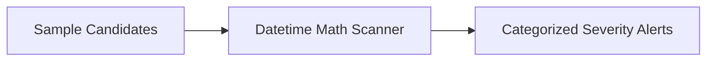
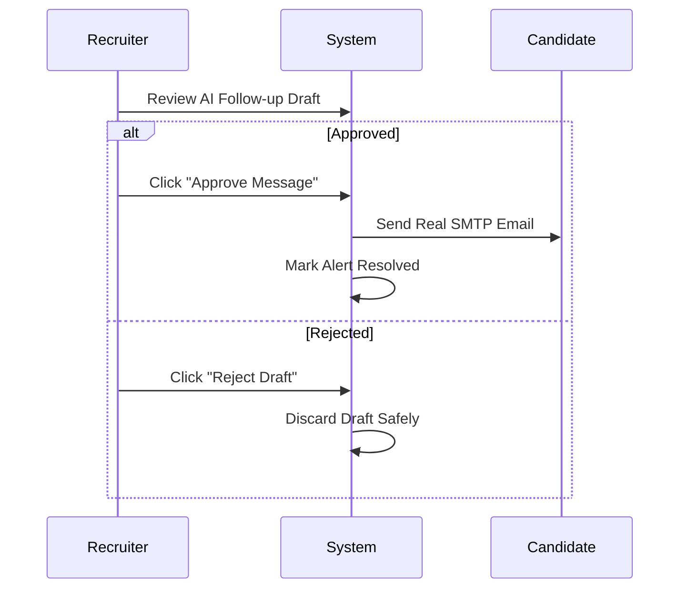

# 5-DAY ENGINEERING LOGBOOK
### A realistic, chronological account of building, refining, and hardening Stall Alerter as a solo developer.

---

## Day 1: Laying the Foundation & The Math Engine
Primary Goal: Build the deterministic core and prove that SLA breach detection works without fancy AI fluff.

- What Got Done:
  - Designed the initial data models in SQLite: `candidates`, `rules`, `alerts`, `actions`, and `audit_events`.
  - Built the deterministic calculation engine: calculated candidate dwell time by subtracting the stage entry timestamp from the current UTC time.
  - Implemented the three severity tiers:
    - Medium: Overrun $\ge 1.0\times$ stage SLA threshold.
    - High: Overrun $\ge 1.5\times$.
    - Critical: Overrun $\ge 2.0\times$.
  - Wrote initial unit tests to make sure leap years, timezone offsets, and malformed dates didn't break the scanner.
- Key Insight of the Day:
  Don't let an LLM touch the math. Keeping date calculations in Python standard library (`datetime`) eliminated 100% of hallucinated alerts.

---

## Day 2: The Recruiter Console & First UI Prototype
Primary Goal: Transform the backend API into a clean, intuitive visual dashboard for hiring teams.

- What Got Done:
  - Set up Next.js 16 (App Router) with TypeScript and Tailwind CSS.
  - Built the main dashboard layout featuring 4 core metric cards: Tracked Candidates, Open Overdue Alerts, Critical SLA Breaches, and Pending Follow-up Drafts.
  - Added tabbed views: Overdue Alerts, All Candidates, Follow-up Drafts, Stage SLA Rules, and Audit Events.
  - Built the CSV Import modal with drag-and-drop file selection and schema verification.
- Key Insight of the Day:
  Recruiters don't want complex menus. Everything important needs to be visible in one primary screen with tabs.

---

## Day 3: AI Communication Drafter & Real Email Dispatch
Primary Goal: Create polite, customized outreach drafts and establish a safe human approval gate.

- What Got Done:
  - Implemented the draft generation endpoint (`POST /api/alerts/{id}/draft`). It takes the candidate's name, role, current stage, and idle days, and writes an empathetic update email.
  - Integrated a real SMTP mailer (`smtplib`) so approved messages actually land in candidate inboxes instead of just being logged in the database.
  - Connected the human approval gate: drafts start in `draft` status and require an authenticated user click to become `approved`.
  - Added polite rejection capabilities for situations where the hiring team decides not to move forward.
- Key Insight of the Day:
  Autonomous email sending is dangerous. Adding the recruiter approval gate gave me peace of mind and prevented accidental candidate emails.

---

## Day 4: Files Archive & Pipeline Stage Progression
Primary Goal: Give recruiters full control over their uploaded data and pipeline transitions.

- What Got Done:
  - Added the Files & Batches section in the UI and backend (`uploaded_files` table).
  - Stored raw CSV file content and metadata (filename, upload timestamp, recruiter name, row count) so recruiters can re-download past files at any time.
  - Added the Candidate Stage Advancement feature:
    - Added the `Move ` button in the candidate directory.
    - Added an optional stage dropdown in the Review & Approve modal.
    - Moving a candidate to the next stage updates `stage_entered_at` to the current timestamp, immediately resetting their idle dwell time to `0.0 days` and auto-resolving their open overdue alerts.
- Key Insight of the Day:
  Solving a stall shouldn't just mean emailing; it often means moving the candidate to the next interview round. Linking stage advancement directly to alert resolution saved recruiters tons of repetitive clicks.

---

## Day 5: Cloud Deployment, 1-Click Polish & Production Hardening
Primary Goal: Deploy to production, fix UI papercuts, and harden the system against double-clicks and freezes.

- What Got Done:
  - Deployed the Next.js frontend to Vercel (`https://stall-alert.vercel.app`) with custom headers and API key security.
  - Deployed the FastAPI backend to Render (`https://stall-alert.onrender.com`) with automated health checks and persistent SQLite volume storage.
  - 1-Click Regeneration: Added the Regenerate button inside the approval modal to re-synthesize draft messages instantly if the recruiter wants different wording.
  - Optimistic Approval Lock: Eliminated the annoying double-click bug on the "Approve Message" button by instantly closing the modal, locking submission state, and showing a smooth processing toast.
  - Auto-Closing Import Modal: Fixed the CSV upload modal so it displays a clean `Success! Imported X rows` alert and smoothly auto-closes after 1.5 seconds, refreshing the dashboard automatically.
  - Synchronized and updated all project documentation (`README.md`, `DIRECTIVE.md`, `UNLEARNED.md`, `API.md`, etc.).
- Key Insight of the Day:
  Small UI polish items (like not having to click twice, or a modal closing itself after success) make the difference between a prototype and software people actually love using.
