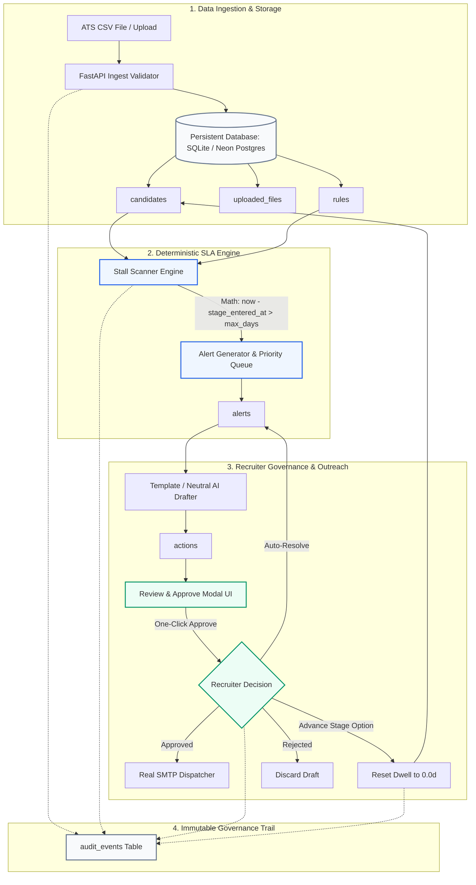
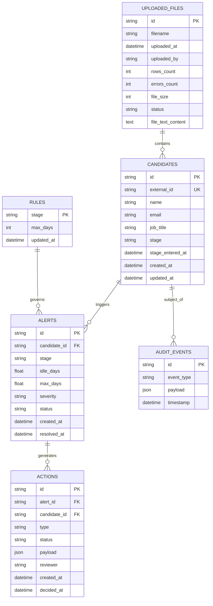
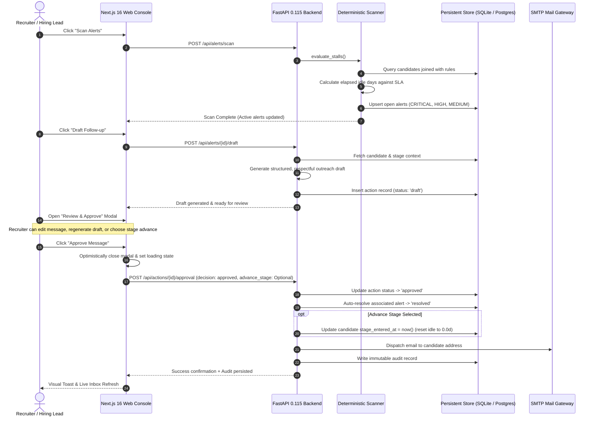

# STALL ALERTER — Architecture Specification (v2.5.0)

## 1. System Overview & Core Philosophy
Stall Alerter is a high-reliability hiring pipeline monitoring and recruiter decision-support system. It protects candidate engagement, hiring team brand reputation, and recruitment throughput by preventing candidates from silently stalling at critical interview stages.

### Guiding Principles
- **Strictly Deterministic SLA Calculations:** Timestamps, idle day calculations, breach detections, and severity tiering are 100% mathematical and rule-governed.
- **Human-in-the-Loop Governance:** AI drafts communications, but zero external messages or stage changes ever leave the system without explicit, authenticated recruiter sign-off.
- **Immutable Audit Trail:** Every ingest, scan, alert transition, draft edit, approval, rejection, and stage advance is recorded permanently with full provenance.
- **Zero Hallucination Surface:** AI is quarantined strictly to communication drafting and summarization; it has zero authority to alter candidate records, delete data, or bypass SLA rules.

---

## 2. High-Level Architecture Diagram

---

## 3. Data Model & Entity Relations (ERD)

---

## 4. Operational Sequence: Overdue Alert to Candidate Delivery

---

## 5. Security Architecture & Threat Boundaries

1. **Untrusted External Data (CSV Ingestion):**
   - Ingested files undergo row-by-row structural validation.
   - Text fields starting with formula trigger tokens (`=`, `+`, `-`, `@`) are sanitised or quoted to eliminate CSV Formula Injection (Excel Macro attacks).
2. **Deterministic Process Isolation:**
   - LLM generation logic is strictly encapsulated behind the `POST /api/alerts/{id}/draft` and `/regenerate` endpoints. It has no write credentials to the database.
3. **Database Migration & Concurrency:**
   - Automatic SQLite table creation and column alteration migrations (`uploaded_files`, `file_text_content`) run on backend boot (`init_db()`), enabling seamless zero-downtime restarts.
4. **Credential Isolation:**
   - Production API keys and SMTP credentials are provided strictly through system environment variables (`API_KEY`, `SMTP_USER`, `SMTP_PASSWORD`) and are omitted from all Git tracking.
