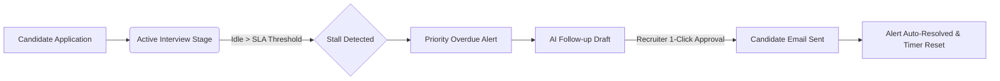

# FINAL DIRECTIVE & OPERATIONAL CHARTER

Welcome to the internal engineering directive for Stall Alerter. This document lays out the core mission, design boundaries, day-to-day architecture, and non-negotiable engineering principles of this system in clear, simple terms.

---

## 1. The Core Problem I Solve
Every hiring pipeline leaks high-potential candidates because of silent stalling. 
A candidate passes a phone screen or an interview, their profile sits in an Applicant Tracking System (ATS), and nobody reaches out for 10 or 15 days. 
- The candidate assumes they are rejected or feels ignored.
- The company loses top talent to faster competitors.
- Recruiters get overwhelmed by manual spreadsheet tracking.

Stall Alerter exists to make candidate delays completely visible, measurable, and actionable in seconds.



---

## 2. My 4 Golden Rules (Non-Negotiable)

### 1. Deterministic Math Over AI Guesses
I do not use AI to decide if someone is stalled. SLA checks, day counts, and breach severities are 100% pure math:
$$\text{Idle Days} = \text{Current Date} - \text{Stage Entry Date}$$
If a stage limit is 3 days and the candidate has waited 6.5 days, that is automatically a Critical alert ($>2.0\times$). No hallucination, no ambiguity.

### 2. Human-in-the-Loop (No Autonomous Spam)
AI is fantastic at drafting polite, contextual emails in 2 seconds. But AI should never send an email to a real candidate without a human recruiter clicking Approve. 
A human recruiter stays in the driver’s seat at all times.

### 3. Immediate Resolution & Timer Reset
When a recruiter approves an email or moves a candidate to the next stage:
- The overdue alert automatically resolves.
- The candidate's idle timer resets to 0.0 days.
- The recruiter shouldn't have to click multiple different buttons to do one clean task.

### 4. Complete Audit Trail
Every single action—CSV upload, draft regeneration, approval, polite rejection, or stage advancement—is recorded in an immutable audit log. Anyone on the team can see who approved what and when.

---

## 3. High-Level System Architecture

Here is how the moving pieces connect:

```mermaid
graph TD
    subgraph UI ["Recruiter Interface (Next.js 16)"]
        Console[Operations Dashboard]
        UploadModal[CSV Ingestion Modal]
        ApprovalModal[Review & Approve Outreach Modal]
    end

    subgraph Backend ["FastAPI Engine (Python 3.11/3.14)"]
        Scanner[Deterministic SLA Scanner]
        Drafter[Contextual Draft Generator]
        EmailService[Real SMTP Mailer]
    end

    subgraph Storage ["Persistent Storage"]
        DB[(SQLite / PostgreSQL)]
        FilesTbl[Ingested CSV Archive]
        AuditTbl[Immutable Audit Events]
    end

    UploadModal -->|POST /api/candidates/import| Backend
    Console -->|POST /api/alerts/scan| Scanner
    Scanner -->|Read & Update| DB
    ApprovalModal -->|POST /api/actions/{id}/approval| Backend
    Backend -->|Send Email| EmailService
    EmailService -->|Real Delivery| CandidateInbox[Candidate Inbox]
    Backend --> AuditTbl
    UploadModal --> FilesTbl
```

---

## 4. System Capabilities Matrix

| Feature | What It Does | Why It Matters |
|---|---|---|
| Bulk CSV Ingestion | Upload candidate records with email, role, stage, and timestamps. | Works with exports from Greenhouse, Lever, Workday, or spreadsheets. |
| Files & Batches Tab | Stores uploaded files, row counts, and lets you re-download the original CSV. | Perfect audit trail and backup. |
| Deterministic Scanner | Evaluates pipeline candidates against customizable SLA thresholds. | Instantly spots neglected candidates without human bias. |
| 1-Click Regenerate | Freshly rewrites follow-up drafts with a single click. | Gives recruiters instant variety in tone and message styling. |
| Optimistic Approval | Closes approval modal immediately and dispatches email via SMTP. | Fast, snappy recruiter experience with zero double-click bugs. |
| Stage Progression | Move candidate to the next stage directly from Candidate list or Approval modal. | Keeps pipeline current and resets the SLA timer cleanly. |
| Bulk Deletion | Clean up test candidates or resolved alerts in batches. | Keeps your workspace tidy with minimal effort. |

---

## 5. Deployment Topology

- Frontend: Deployed globally on [Vercel](https://stall-alert.vercel.app) using Next.js 16 with Turbopack.
- Backend: Hosted on [Render](https://stall-alert.onrender.com) running FastAPI with automatic healthchecks.
- Mail Gateway: Direct SMTP integration configured for candidate outreach.
- Local Fallback: Runs locally in seconds on Windows, macOS, or Linux using standard Python and Node.js tools.
