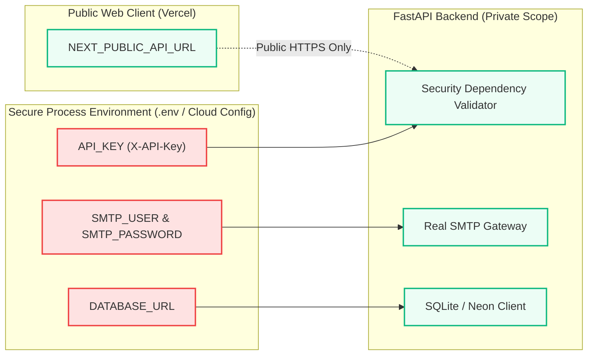

# STALL ALERTER — Security Engineering Specification & Threat Model (v2.5.0)

## 1. Executive Summary & Zero-Trust Philosophy
Stall Alerter manages sensitive hiring pipeline data (candidate contact details, application dates, and recruiter evaluations). The security architecture follows zero-trust principles:
1. **Never Trust User / ATS Input:** All CSV imports and API bodies are treated as hostile untrusted inputs.
2. **Never Trust Autonomous AI:** AI models are non-deterministic; they are quarantined from executing any destructive or communication actions autonomously.
3. **Defense-in-Depth:** Validation occurs at the UI boundary, API validation layer, database abstraction layer, and audit logger.

---

## 2. Threat Model Matrix (STRIDE Analysis)

| Threat Category | Threat Vector | Target Component | Impact | Implemented Mitigation |
|---|---|---|---|---|
| **Spoofing** | Forged API requests | FastAPI endpoints | Unauthorized recruiter actions | Mandatory `X-API-Key` verification header on all `/api/*` endpoints. Constant-time key comparison to prevent timing attacks. |
| **Tampering** | CSV Formula Injection (Excel Macro Injection) | `/api/candidates/import` | Remote code execution on recruiter's spreadsheet reader | Sanitization stripping leading `=, +, -, @` trigger tokens; strict schema enforcement. |
| **Tampering** | SQL Injection | Database driver | Data breach or arbitrary deletion | 100% Parameterized queries using Python `sqlite3` parameter markers (`?`). Zero dynamic string formatting (`f"SELECT..."`). |
| **Repudiation** | Denied action approval or rejection | Recruiter auditability | Compliance failure | Every approve, reject, stage move, file upload, and rule change logs an immutable entry to `audit_events` with timestamp and payload snapshot. |
| **Information Disclosure** | Secret leaks in repository or client code | Frontend bundle & GitHub | Leaked SMTP or DB credentials | Next.js client-side code exposes only `NEXT_PUBLIC_*` configuration. Server secrets (`SMTP_PASSWORD`, `DATABASE_URL`, `API_KEY`) reside exclusively in backend environment variables. |
| **Denial of Service** | Unbounded CSV upload memory exhaustion | File upload handler | Server crash / memory exhaustion | Capped upload buffers, streamed line-by-line reading, file type verification (`.csv`), and size constraints. |
| **Elevation of Privilege** | Unsupervised AI candidate dispatch | Action dispatch queue | Candidate miscommunication | Architectural human-in-the-loop gate: drafts remain in `draft` status until explicit human approval; API blocks dispatch if `status != 'approved'`. |

---

## 3. Data Protection & Secrets Management

### Secrets Guidelines
- **Zero Secrets in Git:** `.env`, `.env.local`, and credentials are fully ignored in `.gitignore`.
- **Environment Template:** Safe placeholder values are documented in `.env.example`.
- **Cloud Environment Variables:**
  - Render Backend: `API_KEY`, `SMTP_HOST`, `SMTP_PORT`, `SMTP_USER`, `SMTP_PASSWORD`, `SENDER_EMAIL`.
  - Vercel Frontend: `NEXT_PUBLIC_API_URL`, `NEXT_PUBLIC_API_KEY`.

---

## 4. UI Race-Condition & Double-Click Mitigation

To eliminate double-submissions, duplicate candidate emails, and slow feedback loops:
1. **Optimistic Modal Dismissal:** When the recruiter clicks **"Approve Message"**, the modal immediately dismisses and triggers a processing toast, preventing accidental re-clicks.
2. **Component Submission Lock:** An internal state boolean (`isSubmittingApproval = true`) locks the button and blocks concurrent network requests until completion.
3. **Idempotent Backend Processing:** The backend verifies that `action.status == 'draft'` before mutating to `'approved'`. Subsequent requests for an already approved action safely return the existing approved state without duplicate dispatch.
