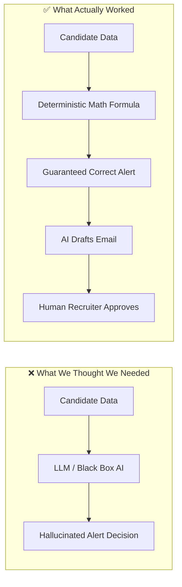

# WHAT WE UNLEARNED BUILDING STALL ALERTER
### A One-Page Reflection on Simplicity, AI Hype, and Real-World Software

---

When we started building **Stall Alerter**, we had a head full of common industry assumptions: *"Put AI everywhere,"* *"Automate every step,"* and *"Use the newest shiny microservice architecture."*

Over the course of designing, implementing, and deploying this system, reality taught us different lessons. Here is what we had to **unlearn** to build something genuinely reliable.

---

### 1. Unlearned: "AI Should Make the Decisions"
*Old Belief:* We should use an LLM or an AI agent to analyze candidate histories and decide if a candidate is stuck or stalled.  
*Reality:* LLMs are non-deterministic. If you give an LLM dates and ask if 12 days is greater than 5 days, it might give you different confidence scores or misinterpret timezones.  
*What We Did Instead:* We stripped AI completely out of the decision engine. Day counts, overdue checks, and severity tiers are calculated with simple, 100% deterministic Python math ($T_{now} - T_{entered} > SLA$). We reserved AI exclusively for what it does best: drafting polite, human-sounding outreach emails.

---

### 2. Unlearned: "Full Automation is Always the Goal"
*Old Belief:* The dream recruiting tool should automatically email candidates the moment they pass an SLA deadline without bothering the recruiter.  
*Reality:* Autonomous candidate emailing is a nightmare waiting to happen. What if the interviewer just spoke to the candidate on the phone five minutes ago? An automated email saying *"We haven't forgotten you"* looks clumsy and damages company reputation.  
*What We Did Instead:* We built a strict **Human-in-the-Loop** model. The system prepares everything—the alert, the context, the draft, the stage selector—and puts it on a silver platter. The recruiter reviews it and clicks **Approve** with one single tap. Humans stay accountable; machines do the heavy lifting.

---

### 3. Unlearned: "More Complex UI Means More Power"
*Old Belief:* Power users want lots of nested settings, multi-step wizards, and separate pages for each action.  
*Reality:* Recruiters are busy. They spend their days jumping between Zoom calls, LinkedIn, and resumes. If taking action on a stalled candidate takes more than two clicks, they won't do it.  
*What We Did Instead:* We put the entire operational loop on one clean dashboard. You can review an alert, inspect candidate history, reword the message, advance the candidate's stage, and send the email—all inside a single modal in less than five seconds.

---

### 4. Unlearned: "Double-Click Bugs are Trivial Front-End Glitches"
*Old Belief:* If a button needs to be clicked twice, it's just a minor styling or state detail to fix later.  
*Reality:* In an operations console, a sticky button creates anxiety. The user wonders: *"Did the email send? Will the candidate get two copies? Did it crash?"*  
*What We Did Instead:* We implemented optimistic modal closing and an instant submission lock. When you click **Approve Message**, the modal vanishes right away, a toast tells you it's sending, and the background handles the network request cleanly. Speed and confidence come from thoughtful UI feedback.

---

### 5. Final Takeaway
Great software isn't measured by how many complicated libraries or AI models you pack into it. It is measured by whether it quietly, reliably solves a painful real-world problem every single day. 

By unlearning the need for unnecessary complexity, **Stall Alerter** became what software should be: **fast, predictable, and genuinely helpful.**
